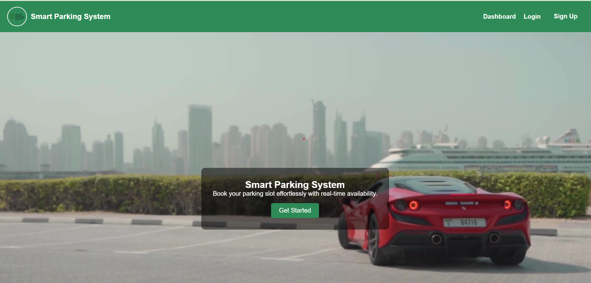
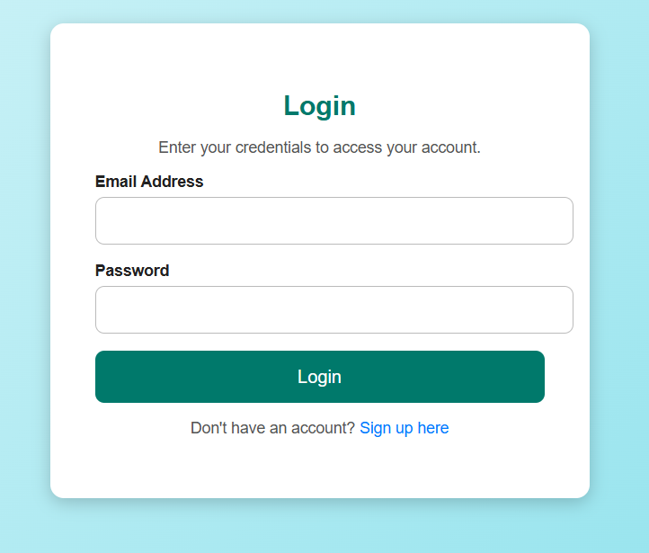
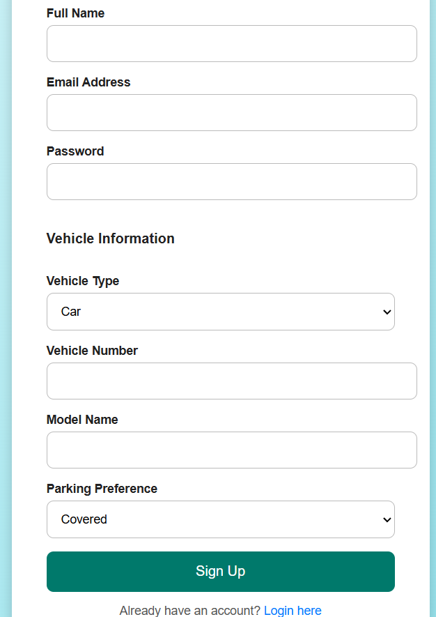
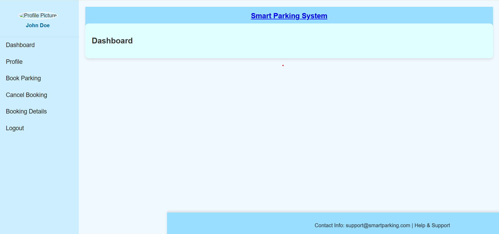
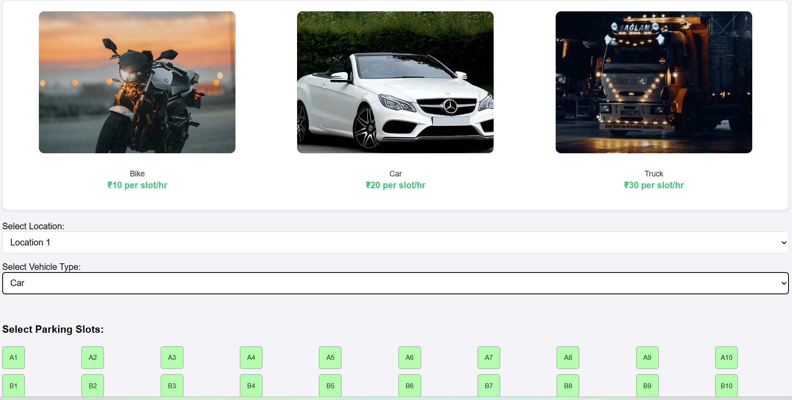
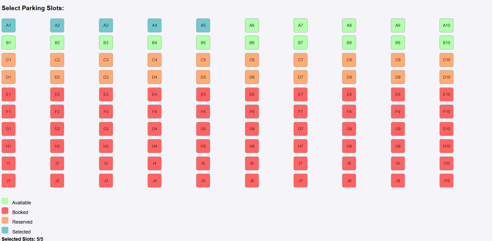
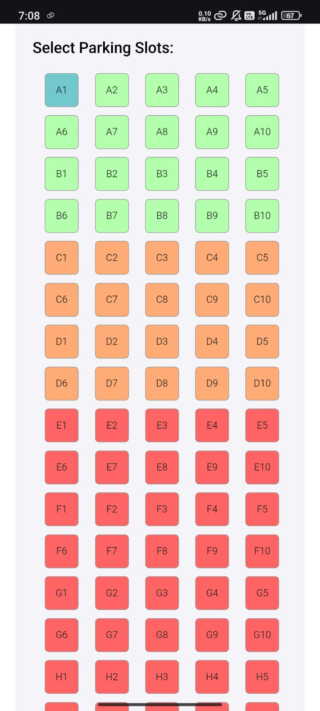
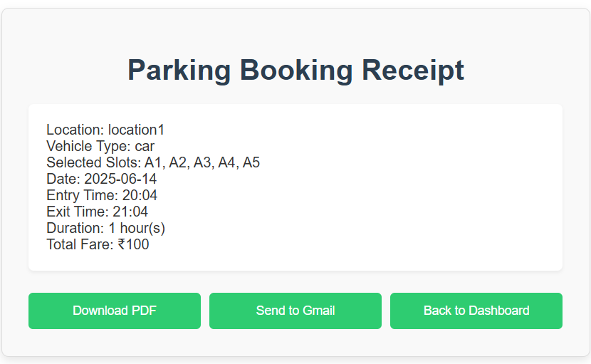
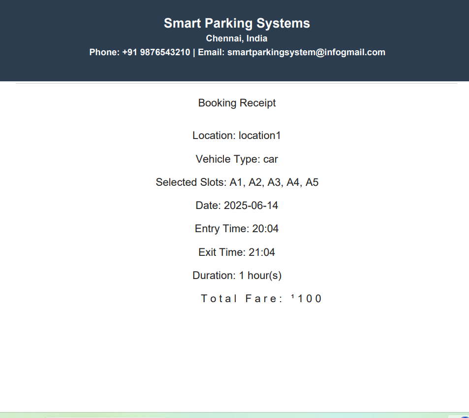

# Smart Parking System 🅿️

A responsive and interactive parking slot booking system built using **HTML**, **CSS**, and **JavaScript**. Users can register, log in, and book parking slots based on vehicle type, location, and availability. Designed to simulate real-world parking logic with a clean and user-friendly interface.

---

## 📸 Screenshots

All screenshots are placed in the `screenshots/` folder.

| Page | Preview |
|------|---------|
| 🏠 Homepage |  |
| 🔐 Login |  |
| 📝 Signup |  |
| 🧭 Dashboard |  |
| 📍 Booking Page (Empty Slots) |  |
| 🎯 Booking Page (With Selection) |  |
| 📱 Booking (Mobile View) |  |
| 🧾 Receipt Page |  |
| 📄 PDF Preview |  |

---

## 📁 Project Structure & Pages

### `index.html` – Landing Page
- Navigation: **Dashboard**, **Login**, **Signup**
- Background video that:
  - ⏸️ Pauses on mouse hover
  - ▶️ Plays when hover ends
  - 🎬 Click to pause/play toggle
- Fully responsive across devices

---

### `signup.html` – User Registration
- Fields:
  - Full Name, Email, Password
  - Vehicle Type: **Car**, **Bike**, **Truck**
  - Vehicle Number, Model Name
  - Parking Preference: **Covered / Open**
- User data is stored in **local storage**

---

### `login.html` – User Login
- Inputs: **Email** and **Password**
- Validates with **local storage**
- Redirects to dashboard on success

---

### `dashboard.html` – User Hub
- Links to:
  - Profile
  - Book Parking
  - Cancel Parking *(not yet added)*
  - Booking Details *(not yet added)*
  - Logout

---

### `booking.html` – Book Parking Slots

#### 💲 Pricing:
| Vehicle | Rate (₹/slot/hr) |
|---------|------------------|
| Bike    | 10               |
| Car     | 20               |
| Truck   | 30               |

#### 📍 Location & Slot Availability:

| Location    | Bike | Car | Truck |
|-------------|------|-----|-------|
| Location 1  | 80   | 20  | ❌ Not Available |
| Location 2  | 50   | 40  | 10    |
| Location 3  | 10   | 30  | 60    |

#### 🧠 Booking Rules:
- Max **5 slots** per transaction
- Future **date**, **entry**, and **exit time** required
- Invalid vehicle types at a location (e.g., truck at Location 1) show red
- Responsive grid layout:
  - **Mobile**: 5 slots/row (A1–A5)
  - **Laptop**: 10 slots/row (A1–A10)

---

### 🎨 Slot Color Legend (CSS)

| Status     | Description            | Color Code  |
|------------|------------------------|-------------|
| ✅ Available | Slot is available      | `#B3FFAE`   |
| ❌ Booked    | Slot is booked         | `#FF6464`   |
| ⏳ Reserved  | Slot is reserved       | `#FFAB76`   |
| 🔘 Selected  | Slot is selected       | `#71C9CE`   |

---

### `receipt.html` – Booking Confirmation
- Displays:
  - Location, Vehicle Type
  - Selected Slots, Date
  - Entry Time, Exit Time
  - Duration, Total Fare
- Buttons for:
  - 📥 Download PDF (via `receipt.js`)
  - 🔙 Back to Dashboard
  - 📧 Send to Gmail *(not functional yet)*

---

## ⚙️ Technologies Used

- **HTML5**
- **CSS3**
- **JavaScript (ES6)**
- **Local Storage**
- **Responsive Design**

---

## 🚧 Future Improvements

- ❌ Cancel Parking
- 📜 Booking History Page
- 📧 Email Integration
- 🛠️ Admin Panel

---

